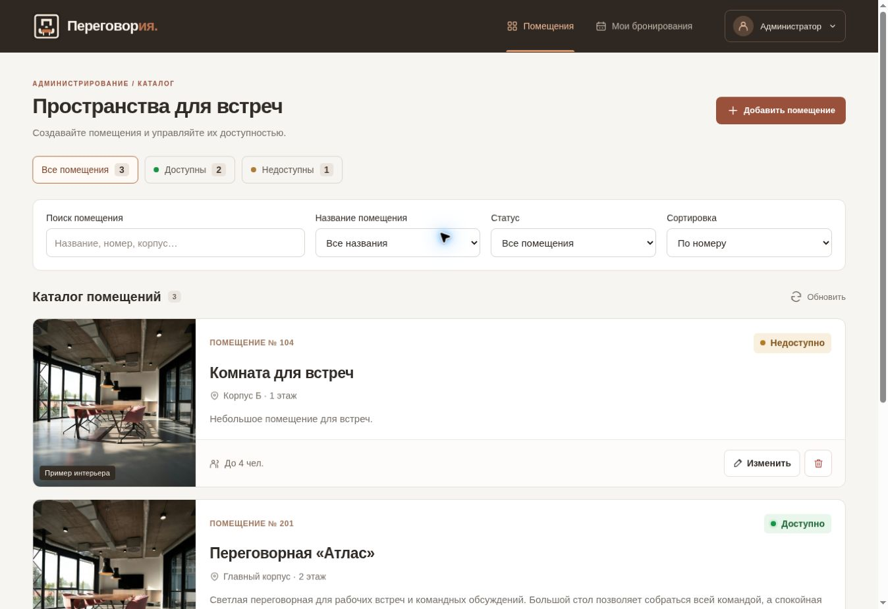
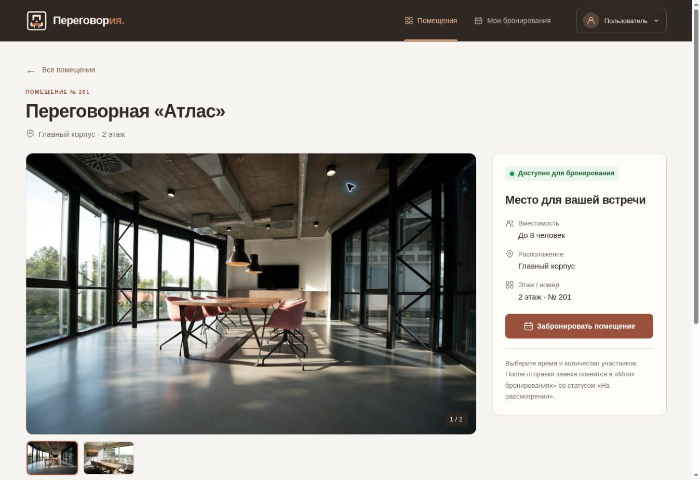

# Лабораторная работа №5 — «Переговория»

React-клиент системы бронирования помещений, собственный REST API на Express, Sequelize и PostgreSQL. Ветка для сдачи: **`25`**.

## Интерфейс



- Вход `/login` и регистрация `/register`. После регистрации выполняется вход и проверка профиля на сервере.
- В шапке только две вкладки: «Помещения» и «Мои бронирования». Имя и стандартная круглая аватарка открывают попап с почтой, ролью, ID и выходом. Отдельных страниц профиля и пользователей в UI нет.
- Компактные счётчики «Все помещения / Доступны / Недоступны» работают как фильтры. Панель поиска и сортировки сохранена. Фильтр названия использует поле `Room.name`, отдельного поля типа в модели нет.
- Помещения представлены списком по образцу `getdhed/library`: фото слева, описание и действия справа. На телефоне изображение располагается над текстом. Цвета и фирменный знак сохранены.
- Создание, редактирование, бронирование и подтверждение удаления открываются в нативном `dialog`. Escape закрывает окно, фокус возвращается к предыдущему элементу. Во время отправки бронирования закрытие заблокировано.
- Ошибки запросов, пустые результаты, повтор загрузки и сохранение черновика после неудачного POST/PUT.
- Статусы стали крупнее и контрастнее: подпись и цветная метка на подложке. Статусы бронирований отображаются по-русски.
- Нажатие на карточку открывает **`/rooms/:id`**. Страница получает помещение через GET `/rooms/:id`, показывает галерею, полное описание, оснащение и характеристики. Прямую ссылку можно обновить или открыть в новой вкладке. Работают кнопки браузера «Назад»/«Вперёд».
- Кнопка «Забронировать помещение» находится на странице помещения и открывает прежний диалог с временем, участниками и целью встречи. Добавлен расчёт продолжительности. Для закрытого помещения бронирование отключено.



## Соответствие заданию

| Требование | Реализация |
| --- | --- |
| Собственный API | Express + Sequelize + PostgreSQL, маршруты `/rooms`, `/auth`, `/profile`, `/bookings` |
| JWT | `client/src/api.js`: Bearer из localStorage, однократное обновление access token через refresh token |
| GET, loading, error, «Повторить» | `App.jsx`, `loadRooms` |
| POST с временным ID | `createOptimistically`: временная карточка → серверный объект; откат и восстановление формы при ошибке |
| PUT с откатом | `updateOptimistically`: немедленное обновление карточки; восстановление исходной записи и введённого черновика при ошибке |
| DELETE с откатом | `removeRoom`: удаление из state; возврат в прежнюю позицию при ошибке |
| Дополнительное улучшение | `AbortController`: отмена предыдущего GET и cleanup при смене профиля/размонтировании |
| Поиск и сортировка | Локальная фильтрация по названию, номеру, расположению; доступность; сортировка |
| Проверка прав | GET помещений — вошедшим; POST/PUT/DELETE помещений — администраторам |

CRUD по заданию выполняется **над помещениями под аккаунтом администратора**. Обычный пользователь просматривает каталог, открывает страницу помещения и отправляет заявку оттуда. GET `/bookings` возвращает только его записи, администратору — все записи. ID автора заявки берётся из проверенного JWT.

## Фото помещений

У помещения есть необязательное поле `imageUrl`. Администратор задаёт HTTP(S)-ссылку в форме создания/редактирования. Ссылка сохраняется в PostgreSQL и возвращается GET `/rooms`; недопустимые протоколы сервер отклоняет с 400. Удаление ссылки возвращает демонстрационное превью. При ошибке загрузки фото показывается пример интерьера.

Встроенные фото из `client/public/rooms` — **демонстрационные**, не реальные снимки помещений проекта; они помечены «Пример интерьера». Источники указаны в `client/public/rooms/README.md`. Образец интерфейса: `frontend/src/components/Layout.tsx` и `DocumentListItem.tsx` репозитория [getdhed/library](https://github.com/getdhed/library).

При обновлении уже установленного проекта выполните **из корня**, до запуска Express:

```bash
npx sequelize-cli db:migrate
```

Миграции добавляют `Rooms.imageUrl`, а также массивы `galleryUrls` и `amenities` с пустыми значениями по умолчанию. Существующие записи сохраняются. Новая миграция: `20261103160000-add-room-gallery-and-amenities.js`.

Администратор может указать до **8 дополнительных фото** (HTTP(S)-ссылки, каждая с новой строки), до **12 удобств** (через запятую) и описание до **2000 символов**. Информация об оснащении не придумывается: если поле пустое, страница сообщает, что данные не указаны. Если у помещения нет собственных фото, остаётся демонстрационный пример интерьера.

## Запуск

Нужны Node.js, npm и PostgreSQL. Сервер находится **в корне репозитория**, отдельной папки `server` нет.

```bash
git switch 25
npm ci
```

Создайте корневой `.env`:

```dotenv
DB_USER=your_user
DB_PASSWORD=your_password
DB_NAME=your_database
DB_HOST=localhost
DB_PORT=5432
JWT_SECRET=replace_with_your_secret
```

Создайте базу PostgreSQL, затем выполните миграции и запустите сервер:

```bash
npx sequelize-cli db:migrate
npm run dev
```

В другом терминале:

```bash
cd client
npm ci
```

Создайте `client/.env` по `client/.env.example`:

```dotenv
VITE_API_URL=http://localhost:3000
```

```bash
npm run dev
```

Откройте `http://localhost:5173`. Для прямых запросов Express разрешает CORS с `localhost:5173` и `127.0.0.1:5173`. Если порт другой, задайте корневой `CLIENT_ORIGINS` через запятую и перезапустите Express.

Альтернатива для разработки: `VITE_API_URL=/api`. Vite перенаправляет `/api/*` на Express `localhost:3000`, удаляя префикс. На самом Express префикса `/api` нет. Для production задайте адрес опубликованного API или настройте аналогичный reverse proxy; dev proxy Vite в production-сборку не входит.

## Аккаунт администратора

Публичная регистрация всегда создаёт `role = user`. Для проверки CRUD зарегистрируйте аккаунт и в **своей локальной БД** назначьте ему роль:

```sql
UPDATE "Users" SET role = 'admin' WHERE email = 'your-admin@example.com';
```

Выйдите и войдите снова. Роль проверяется по базе на сервере, а не по localStorage. Не сохраняйте `.env`, пароли и токены в Git.

## Проверки

Клиентские тесты без запущенной БД:

```bash
cd client
npm test
npm run build
```

Восемь тестов проверяют заголовок JWT, передачу AbortSignal, методы и JSON, 204, HTTP 500, сетевой сбой, занятую почту, отмену запроса, общий refresh для параллельных 401 и очистку отклонённой сессии. Некоторые сценарии объединены в одном тесте. Эти тесты также запускаются в GitHub Actions.

Интеграционная проверка при работающих Express и PostgreSQL, из корня:

```bash
LAB5_EMAIL=your-admin@example.com LAB5_PASSWORD=your_password node scripts/lab5-smoke-test.mjs
```

Она создаёт уникальное тестовое помещение, выполняет GET/POST/PUT/DELETE и удаляет только свою запись. В PowerShell задайте переменные через `$env:LAB5_EMAIL` и `$env:LAB5_PASSWORD`.

### Выполненная проверка этой доработки

- Production-сборка React и 8 тестов API-сервиса.
- Серверный CRUD smoke test; регистрация/вход; отсутствие чужих бронирований в пользовательском списке; администратор видит все; чужой ID — 404; запись обычным пользователем — 403; удаление помещения с бронированием — 409.
- В браузере: создание, редактирование, удаление; принудительный 503 для POST/PUT/DELETE с откатом; восстановление черновика; ошибка GET и «Повторить»; поиск и сброс; форма бронирования (проверка предыдущей версии интерфейса).
- Узкий экран в iframe шириной 390 px: одна колонка, компактные фильтры, без горизонтального переполнения страницы.

Для этих проверок использовались собственный Express и миграции проекта с временной **PGlite (PostgreSQL WASM)**, не пользовательская база. Настоящая локальная PostgreSQL пользователя в этом окружении не проверялась. Отправка бронирования проверена через API; заполнение нативных datetime-полей и отправка этой формы целиком через браузерную автоматизацию не подтверждены. Временные фикстуры и тестовые входы не входят в исходники.

### Проверка попапа и превью

После этой доработки повторно прошли 8 тестов API, production-сборка и CRUD smoke test на Express с миграциями проекта и PGlite. Smoke test проверяет также сохранение `imageUrl` после POST/PUT/GET и отклонение `javascript:`.

В браузере с временными ответами API проверены: две вкладки; попап для ролей user/admin; центрирование данных; Escape и клик снаружи; выход; демонстрационные фото; сохранение и перечитывание ссылки на фото; узкий экран в iframe 390px без горизонтального переполнения. Временные UI-фикстуры удалены перед коммитом. Настоящая PostgreSQL пользователя не подключалась.

### Проверка страницы помещения

Для последней доработки повторно пройдены production-сборка и 8 клиентских тестов. Добавлен тест GET одного помещения, передачи AbortSignal и обработки 404. Расширенный CRUD smoke test на Express + PGlite с миграциями проверяет сохранение галереи/оснащения, а также отклонение недопустимых ссылок и неверного типа удобств.

В браузере на временных ответах API проверены:

- нажатие на всю карточку и отдельная работа кнопки редактирования;
- компактные фильтры, яркие статусы, полный текст и характеристики;
- переключение фото и открытие попапа бронирования со страницы;
- прямой URL `/rooms/1` после перезагрузки, возврат в каталог и «Назад» браузера;
- 404, ошибка GET 503 и успешная повторная загрузка;
- отключённое бронирование закрытого помещения;
- сохранение оснащения в форме и его обновление на странице после PUT;
- iframe 390px: галерея сверху, блок бронирования ниже, без горизонтального переполнения.

Скриншоты сделаны на демонстрационных данных. Временная UI-фикстура не входит в репозиторий. Проверка полного отправления формы бронирования с нативными datetime-полями через автоматизацию по-прежнему не подтверждена; проверьте этот сценарий вручную на своей PostgreSQL.

### Что проверить перед сдачей

1. Повторите smoke test на своей PostgreSQL и под своим администратором.
2. В открытом кабинете остановите Express и нажмите «Обновить»: появится ошибка. Запустите Express и нажмите «Повторить». При перезагрузке всей страницы сначала проверяется `/profile`, поэтому при отключённом сервере откроется экран входа с ошибкой сессии.
3. В DevTools → Network включите Slow 3G для скриншота загрузки и наблюдения временной карточки.
4. Для демонстрации отмены запустите медленный GET и выйдите из кабинета: cleanup вызывает `abort()`. В StrictMode первый dev-запрос также может отменяться.
5. Проверьте отправку бронирования с будущим временем из браузера.

## Отчёт

`REPORT-LAB5.md` остаётся **черновиком**: содержит схему взаимодействия, фрагменты кода и ответы на 16 вопросов. Для сдачи нужны титульный лист, реальные скриншоты всех требуемых состояний и экспорт в PDF. Один скриншот кабинета в `docs/screenshots` не заменяет полный комплект отчёта.

Проверка временных пересечений бронирований на сервере пока не реализована; флаг «Доступно» означает `Room.isActive`, а не свободное время в календаре.

## Документация

- [React useEffect](https://react.dev/reference/react/useEffect)
- [Fetch и AbortController](https://developer.mozilla.org/en-US/docs/Web/API/Fetch_API/Using_Fetch)
- [Нативный dialog](https://developer.mozilla.org/en-US/docs/Web/HTML/Element/dialog)

При публикации фронтенда настройте SPA fallback: запросы интерфейса `/rooms/:id` и `/bookings` должны возвращать `index.html`. Vite dev server уже обрабатывает эти адреса. Express API использует свои отдельные маршруты через `VITE_API_URL`.
