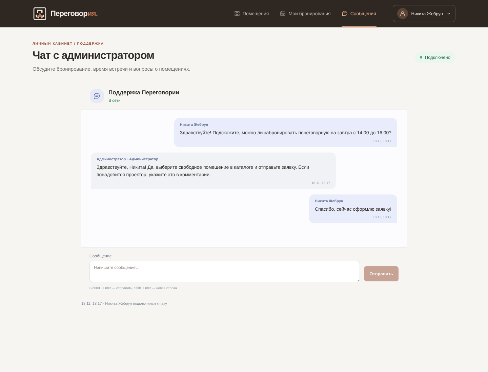
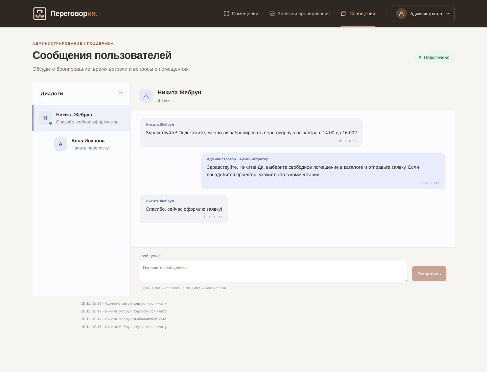
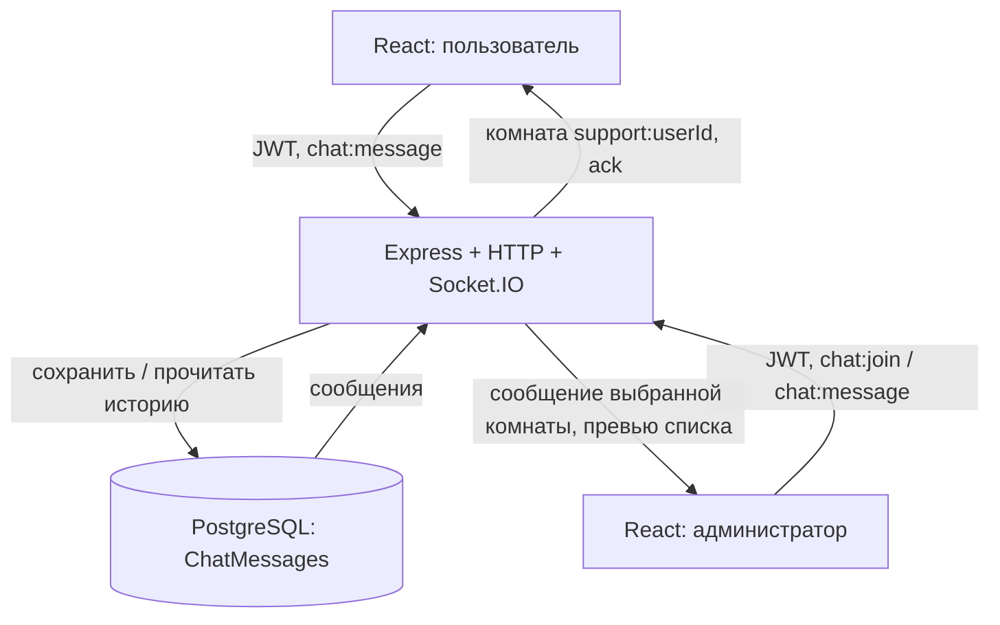

# ЛР7. Реализация реального времени с WebSocket

Ветка: **27**. Предметная область: бронирование помещений.
Цель: освоить двустороннее взаимодействие в реальном времени на Socket.IO.
Реализован простой мессенджер пользователя и администраторов системы.

## Что реализовано

- Раздел **«Сообщения»** (`/messages`) в существующем React-приложении.
- У пользователя — один личный диалог с поддержкой, у администратора — список
  пользователей и выбор диалога. Администратор может первым начать переписку.
- Отправка и получение сообщений без обновления страницы.
- Закрытые комнаты `support:<userId>`: чужие диалоги пользователю недоступны.
- История в **PostgreSQL через Sequelize**, таблица `ChatMessages`.
  MongoDB не обязательна для этой работы; используется существующая БД проекта.
- Первые 50 последних сообщений, кнопка загрузки предыдущих страниц.
- Статус «В сети», события подключения/отключения, индикатор «печатает».
  Несколько вкладок одной учётной записи учитываются как один онлайн-пользователь.
- Превью последнего сообщения и счётчик новых сообщений в других диалогах администратора
  во время открытого раздела «Сообщения». Счётчик хранится в состоянии компонента.
- JWT при подключении; отправитель и роль определяются сервером. При действиях
  повторно проверяется существование аккаунта и неизменность его роли.
- Ack после сохранения в БД; таймаут 8 секунд, черновик остаётся для повторной отправки.
  UUID и уникальный индекс `(senderId, clientMessageId)` защищают повтор неизменённого
  сообщения от дублирования после потери ack.
- Сообщения от 1 до 2000 символов, пакет не больше 16 КиБ, до 10 попыток отправки
  за 10 секунд на аккаунт среди его активных соединений одного сервера.
- При разрыве сети отправка недоступна; Socket.IO переподключается, клиент заново
  входит в комнату и загружает последние сообщения из БД. Более ранние доступны кнопкой.
  При истечении JWT используется существующий механизм обновления через `/profile`.

## Запуск

Нужны **Node.js 22+**, npm и запущенная **PostgreSQL**.
Если проект уже настроен после ЛР5, используйте прежний `.env` и ту же БД.

В корне репозитория:

```bash
git fetch origin
git switch 27
git pull --ff-only origin 27
npm ci
```

Для нового окружения создайте БД `booking_system`, скопируйте корневой
`.env.example` в `.env` и заполните свои реквизиты:

```dotenv
DB_USER=postgres
DB_PASSWORD=your_password
DB_NAME=booking_system
DB_HOST=localhost
DB_PORT=5432
JWT_SECRET=replace_with_a_long_random_secret
PORT=3000
CLIENT_ORIGINS=http://localhost:5173,http://127.0.0.1:5173
```

Примените миграции и запустите сервер:

```bash
npx sequelize-cli db:migrate
npm run dev
```

Новая миграция `20261118190000-create-chat-messages.js` создаёт таблицу
переписки и индексы. `sequelize.sync({ force: true })` не используется.

Во втором терминале из корня:

```bash
cd client
npm ci
npm run dev
```

По умолчанию React обращается к `http://localhost:3000`. Для явной настройки
можно скопировать `client/.env.example` в `client/.env`.
Альтернатива — `VITE_API_URL=/api`: Vite проксирует HTTP и WebSocket на сервер.
Открывайте `http://localhost:5173`; если Vite выбрал другой порт, освободите 5173
или добавьте фактический origin в корневой `CLIENT_ORIGINS` и перезапустите сервер.
При изменении `PORT` обновите `VITE_API_URL` или target прокси в `client/vite.config.js`.

## Пользователь и администратор

Готовые аккаунты с общим паролем не создаются. Зарегистрируйте **два разных
аккаунта** через интерфейс. Одному в своей PostgreSQL назначьте администратора:

```sql
UPDATE "Users" SET role = 'admin' WHERE email = 'your-admin@example.com';
```

Выйдите из него и войдите снова. Второй аккаунт оставьте с `role = 'user'`.

**Используйте разные браузеры или обычное окно и инкогнито.** Две обычные вкладки
одного origin используют общий `localStorage` с токенами; для двух разных
аккаунтов нужны независимые хранилища браузера.

Откройте «Сообщения» в обоих окнах. Администратор выбирает пользователя слева.
Пользователь сразу видит свой чат с поддержкой. Enter отправляет сообщение,
Shift+Enter добавляет строку. Сообщение можно отправить собеседнику, который
сейчас не в сети: оно сохранится и появится при следующем открытии истории.
Соединение чата существует, пока открыт раздел «Сообщения»; статус относится
к присутствию в чате, а не к нахождению на любой странице сайта.

## Проверка в двух окнах

| Действие | Ожидаемый результат |
| --- | --- |
| Пользователь отправляет вопрос | Он появляется у пользователя и у администратора в выбранном диалоге |
| Администратор отвечает | Пользователь получает ответ без перезагрузки |
| Начать ввод, не отправляя текст | Собеседник видит «печатает…»; текст черновика ему не передаётся |
| Открыть чат ещё одного пользователя | У него отдельная история; чужие сообщения не показываются |
| Администратор переключает диалог | Выходит из прежней комнаты и входит в выбранную; новые сообщения других диалогов видны в превью |
| Закрыть чат пользователя | У администратора появляется событие отключения и меняется статус |
| Оставить вторую вкладку того же аккаунта | Закрытие первой вкладки не меняет аккаунт на офлайн |
| Обновить страницу | История восстанавливается из БД |
| Остановить и снова запустить Express | Клиент показывает потерю связи, затем переподключается; история остаётся |
| Отправить пустую строку или более 2000 символов через клиент Socket.IO | Сервер отклоняет сообщение |
| Попытаться запросить чужой `userId` обычным пользователем | Сервер возвращает отказ |

Скриншоты реального запуска в двух независимых браузерных контекстах:





## Схема взаимодействия



Подключение Socket.IO начинается с Engine.IO handshake. По умолчанию библиотека
может начать с HTTP long polling и затем перейти на WebSocket; Socket.IO
использует собственный протокол поверх транспорта, поэтому нативный
`new WebSocket()` не является заменой `socket.io-client` для этого сервера.

## Файлы и события

| Файл | Назначение |
| --- | --- |
| `server.js` | `http.createServer(app)` и подключение чата к тому же порту |
| `services/supportChat.js` | JWT, комнаты, события, история, presence и лимиты |
| `models/chatmessage.js` | Sequelize-модель сообщения |
| `migrations/20261118190000-create-chat-messages.js` | Таблица, внешние ключи и индексы |
| `client/src/components/SupportChat.jsx` | Клиент Socket.IO и интерфейс |
| `client/src/api.js` | URL/path чата и чтение текущего токена |
| `client/vite.config.js` | Поддержка WebSocket через `/api` proxy |
| `scripts/lab7-chat.test.cjs` | Интеграционная проверка через реальные соединения |

Все пользовательские события с запросом поддерживают callback с
`{ ok: true, ... }` либо `{ ok: false, error }`.

| Событие | Направление и данные |
| --- | --- |
| `connection`, `disconnect` | Сервер: подключение/отключение и учёт вкладок |
| `chat:list` | Клиент → сервер: список доступных диалогов и presence |
| `chat:join` | Клиент → сервер: `{ userId }`; сервер проверяет права, меняет комнату, возвращает последние 50 сообщений |
| `chat:history` | Клиент → сервер: `{ userId, before }`; предыдущая страница по ID |
| `chat:message` | Клиент → сервер: `{ userId, text, clientMessageId }`; сервер сохраняет и отправляет в комнату, ack содержит сообщение |
| `chat:message` | Сервер → клиент: сохранённое сообщение с ID и временем |
| `chat:conversation` | Сервер → администраторы: пользователь и превью последнего сообщения |
| `chat:typing` | В обе стороны: пользователь диалога и флаг набора; сервер сам добавляет имя и ID отправителя |
| `chat:presence` | Сервер → клиент: доступность поддержки; администратору также список ID пользователей в сети |
| `chat:notice` | Сервер → участники с правом доступа: подключение/отключение аккаунта |

`ChatMessages`: `id`, `userId` (владелец диалога), `senderId`, `senderName`,
`senderRole`, `text`, `clientMessageId`, `createdAt`, `updatedAt`.
Имя и роль сохраняются как снимок на момент подключения отправителя.

## Автоматическая проверка

Сборка и существующие тесты клиента:

```bash
cd client
npm test
npm run build
```

Для интеграционных тестов создайте **отдельную тестовую PostgreSQL**,
настройте корневой `.env` на неё и выполните миграции. Основной сервер
для теста запускать не нужно: тест открывает HTTP/Socket.IO на свободном порту,
создаёт собственные временные аккаунты и удаляет их после проверки.

PowerShell:

```powershell
npx sequelize-cli db:migrate
$env:LAB7_TEST = '1'
npm run test:chat
```

Bash:

```bash
npx sequelize-cli db:migrate
LAB7_TEST=1 npm run test:chat
```

В GitHub Actions workflow `lab7.yml` делает эти проверки на PostgreSQL 16
для push в ветку 27. Тесты проверяют JWT и Origin, обмен по WebSocket и polling,
авторство с сервера, изоляцию, ack, повтор без дубля, typing, leave, историю,
переподключение, несколько вкладок, валидацию и ограничение частоты.

## Контрольные вопросы

1. **WebSocket и HTTP.** HTTP строится на запросах клиента и ответах сервера.
   Для доставки новых данных через обычный HTTP нужны polling, long polling
   либо потоковые механизмы вроде SSE. WebSocket после установления соединения
   позволяет обеим сторонам посылать сообщения независимо. HTTP тоже используют
   для real-time, но WebSocket удобен для двустороннего чата. [1, 2]
2. **Почему Socket.IO.** Используется сервер `socket.io` и клиент
   `socket.io-client`: именованные события, комнаты, ack, автоматическое
   переподключение и fallback на polling. Это библиотека с собственным
   протоколом, а не реализация, совместимая с произвольным WebSocket-клиентом. [2]
3. **Комнаты.** Серверные каналы для группы сокетов:
   `socket.join('support:1')`; `io.to('support:1').emit('chat:message', data)`.
   Уход: `socket.leave('support:1')`. В проекте доступ к комнате проверяется
   по ID авторизованного пользователя или роли администратора. [3]
4. **Всем, кроме отправителя.** `socket.broadcast.emit('message', data)`.
   В одной комнате: `socket.to('support:1').emit('message', data)`. [3, 4]
5. **Disconnect.** На сервере и клиенте: `socket.on('disconnect', reason => {})`.
   На сервере корректируем число подключений, на клиенте блокируем отправку
   и показываем потерю связи. При обычной потере сети библиотека переподключается;
   после серверного `socket.disconnect(true)` требуется `socket.connect()`. [5]
6. **Typing.** Отдельное событие `{ userId, typing: true }` без текста.
   Сервер отправляет его другим участникам комнаты. Через паузу, после отправки
   или ухода передаём `false`; получатель также сбрасывает индикатор по таймауту.
   В проекте transient-события передаются через `volatile.emit`. [4]
7. **Данные при подключении.** `io(url, { auth: { token } })`;
   на сервере — `socket.handshake.auth.token`. Имя пользователя в этом проекте
   сервер получает из БД после проверки JWT, чтобы клиент не мог его подменить. [6]
8. **История в MongoDB.** При выборе MongoDB создаём Mongoose schema с
   `userId`, `senderId`, `senderName`, `senderRole`, `text`, `clientMessageId`
   и `timestamps: true`; перед рассылкой вызываем `Message.create(...)`,
   историю читаем `find({userId}).sort({_id:-1}).limit(50)`, добавляем индексы.
   В этой реализации те же данные сохраняются через Sequelize в PostgreSQL;
   Mongoose для чата не подключён. [10; файлы модели и сервиса проекта]
9. **Приватное сообщение по socket.id.**
   `io.to(targetSocketId).emit('private:message', data)`, поскольку сокет
   автоматически состоит в комнате со своим ID. ID меняется при переподключении;
   для постоянного диалога лучше проверенная комната по ID пользователя. [3, 5]
10. **Ack.** Клиент: `socket.timeout(8000).emit('chat:message', data, (err, result) => {})`.
    Сервер принимает callback и вызывает его после успешного сохранения.
    Такой ack означает сохранение на сервере; он не доказывает, что человек
    прочитал сообщение. По умолчанию Socket.IO не гарантирует доставку
    пропущенных серверных событий после переподключения. [4, 7]
11. **Несколько серверов.** Используют Redis adapter для обмена событиями между
    узлами и общую БД истории. При polling нужны sticky sessions на балансировщике.
    Presence и rate limit также нужно вынести в общее хранилище. В текущем
    учебном проекте они находятся в памяти одного Node.js-процесса. [8]
12. **Потеря связи и reconnect.** У Socket: `disconnect`, затем `connect`
    после успешного восстановления, а при ошибке подключения — `connect_error`.
    У Manager (`socket.io`): `reconnect_attempt`, `reconnect`, `reconnect_error`,
    `reconnect_failed`. `connection` — событие сервера. [5]
13. **Размер и частота.** `maxHttpBufferSize` ограничивает размер пакета.
    Отдельно проверяем длину текста и считаем попытки отправки по аккаунту
    за окно времени. Здесь 2000 символов, 16 × 1024 = 16384 байта на пакет,
    10 попыток за 10 секунд; это отдельные ограничения. [9; сервис проекта]
14. **Защита подключения.** Middleware `io.use(...)` проверяет JWT из `auth`,
    получает пользователя и роль из БД и отклоняет соединение через `next(error)`.
    Отдельно проверяется право на каждое действие с диалогом. Origin —
    дополнительная проверка, он не заменяет авторизацию. [6]
15. **Backpressure.** Для прикладной очереди ограничивают число неподтверждённых
    сообщений, ждут ack, вводят таймаут и отключают отправку без связи.
    Здесь одновременно отправляется одно сообщение из формы; большой истории
    нет в одном пакете, она загружается страницами. `volatile.emit` подходит
    для теряемого typing, а сообщения сначала сохраняются в БД.
    Полноценное управление транспортным backpressure в этой работе не реализовано. [4, 7]
16. **Три emit на сервере.** `socket.emit` — одному сокету;
    `io.emit` — всем подключённым сокетам этого namespace;
    `socket.broadcast.emit` — всем, кроме данного сокета.
    На клиенте `socket.emit` отправляет событие серверу. [4]

## Источники

1. [RFC 6455: WebSocket](https://www.rfc-editor.org/rfc/rfc6455)
2. [Socket.IO: Introduction](https://socket.io/docs/v4/)
3. [Socket.IO: Rooms](https://socket.io/docs/v4/rooms/)
4. [Socket.IO: Emitting events](https://socket.io/docs/v4/emitting-events/) и [Broadcasting events](https://socket.io/docs/v4/broadcasting-events/)
5. [Socket.IO: Client Socket](https://socket.io/docs/v4/client-socket-instance/), [Client API / Manager](https://socket.io/docs/v4/client-api/#manager)
6. [Socket.IO: Middlewares](https://socket.io/docs/v4/middlewares/)
7. [Socket.IO: Delivery guarantees](https://socket.io/docs/v4/delivery-guarantees/)
8. [Socket.IO: Multiple nodes](https://socket.io/docs/v4/using-multiple-nodes/) и [Redis adapter](https://socket.io/docs/v4/redis-adapter/)
9. [Socket.IO: Server options / maxHttpBufferSize](https://socket.io/docs/v4/server-options/#maxhttpbuffersize)
10. [Mongoose: Schemas](https://mongoosejs.com/docs/guide.html)

## Вывод

В систему бронирования добавлен чат на Socket.IO: пользователь обсуждает
бронирование с администратором в личной комнате, история хранится в БД,
интерфейс отражает подключение и набор текста. Сервер проверяет авторизацию,
ограничивает сообщения и возвращает результат сохранения через ack.

Отдельный PDF-отчёт для СЭО в эту реализацию кода не включён.
